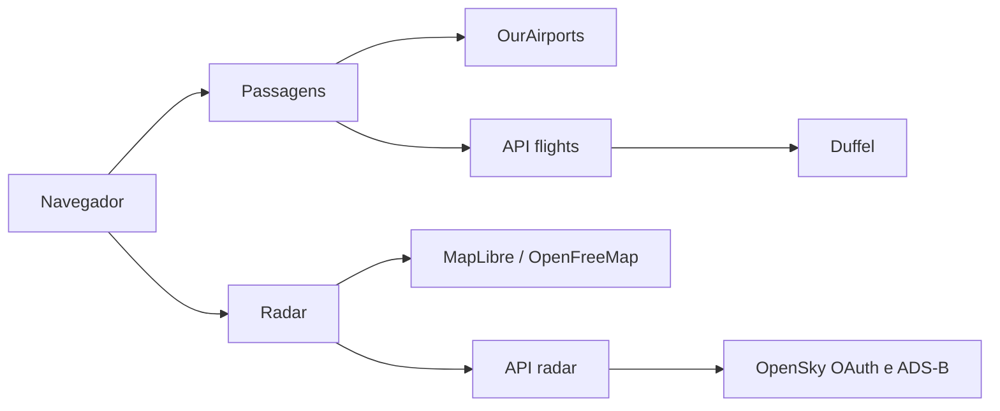

<div align="center">


# zFLY · Aviation Intelligence

**Passagens aéreas e rastreamento ADS-B em uma experiência integrada.**

     

[Visão geral](#funcionalidades) · [Radar](#zfly-radar) · [Arquitetura](#arquitetura) · [Configuração](#executar)

</div>

---

Comparador de voos com identidade visual inspirada em Liquid Glass e Material Design 3. Pesquisa de aeroportos nacionais e internacionais, comparação demonstrativa e consulta opcional de tarifas reais.

## Identidade visual

A marca zFLY combina um símbolo vetorial de asa e bússola com um gradiente azul, ciano e verde. A tipografia Inter e os ícones Material Symbols Rounded complementam a interface. O sistema visual combina Material Design 3, superfícies translúcidas inspiradas em Liquid Glass e assinatura GitHub em formato Dynamic Island nas duas interfaces.

| Tecnologia | Aplicação |
| --- | --- |
| HTML5 | Estrutura semântica das páginas |
| CSS3 | Temas, responsividade e animações |
| JavaScript | Pesquisa, estado da interface e mapa |
| Node.js | Integrações de servidor |
| SVG | Marca e elementos vetoriais |
| MapLibre GL JS / WebGL | Renderização do mapa do radar |

## zFLY Radar

A página `radar.html` apresenta mapa OpenFreeMap, pesquisa por identificação, altitude em metros, velocidade em km/h e posição recebida da OpenSky Network. A atualização periódica é de 60 segundos, com consultas adicionais ao mover o mapa. Até 500 aeronaves são exibidas por consulta. Não há dados fictícios no radar.

### Configuração

Hospede em ambiente Node.js compatível com `GET /api/radar`. Configure no servidor:

| Variável | Finalidade |
| --- | --- |
| `ZFLY_RADAR_ENABLED` | Ativação explícita do endpoint |
| `OPENSKY_CLIENT_ID` | Identificador OAuth do provedor, quando necessário |
| `OPENSKY_CLIENT_SECRET` | Segredo OAuth, somente no servidor |

Antes de ativar, confirme os termos e limites da OpenSky, configure proteção contra abuso e valide a cobertura brasileira. GitHub Pages sozinho não executa o endpoint. O código está publicado; a recepção ADS-B ainda apresenta indisponibilidade e precisa de validação. Não utilizar para navegação aérea.

## Funcionalidades

- Busca de aeroportos por cidade, nome ou código IATA, incluindo Maringá (MGF), com tolerância a acentos.
- Catálogo local de contingência e atualização via [OurAirports](https://ourairports.com/data/), restrita a aeroportos com serviço regular e IATA; cache de sete dias no navegador.
- Ida, ida e volta e múltiplos destinos; filtros, comparação e datas flexíveis no modo demonstrativo.
- Interface responsiva, temas claro/escuro, transparência opcional, animações SVG com respeito a `prefers-reduced-motion` e navegação por teclado.
- Consulta externa via Google e painel separado de ofertas reais Duffel, quando o servidor estiver configurado.

## Arquitetura

```text
zFLY/
├── index.html         # Interface de passagens
├── radar.html         # Interface de rastreamento
├── assets/
│   ├── brand/zfly.svg # Logotipo vetorial
│   ├── css/           # styles.css, identity.css, radar.css
│   └── js/            # app.js, radar.js
├── api/
│   ├── flights.js     # Endpoint Node.js para ofertas reais Duffel
│   └── radar.js       # Endpoint Node.js para posições ADS-B
└── README.md         # Documentação e configuração
```

| Módulo | Responsabilidade |
| --- | --- |
| I18N / Formatters | Traduções, formatação e sanitização |
| AirportCatalog | Catálogo local, atualização, cache, busca e distâncias |
| ProviderAdapters | Simulação local e metadados das integrações |
| SearchService / FilterSortEngine | Pesquisa e filtros demonstrativos |
| UIRenderer / AppController | Interface, eventos e consulta real independente |
| api/flights.js | Validação e comunicação autenticada com a Duffel |

### Fluxo de dados



### Exemplos técnicos

**HTML5 — componentes compartilhados**

```html
<section class="glass-panel" id="detail" aria-live="polite">
  Selecione uma aeronave.
</section>
```

**CSS3 — tokens da identidade visual**

```css
:root {
  --primary: #0b57d0;
  --glass-radius: 22px;
  --glass-blur: 18px;
}
```

**JavaScript — consulta ao radar** (exemplo de uso)

```javascript
const bounds = new URLSearchParams({
  south: -24, north: -15, west: -50, east: -40
});
const response = await fetch('/api/radar?' + bounds);
if (!response.ok) throw new Error('Radar indisponível');
const { aircraft } = await response.json();
```

**HTTP — contrato de integração**

```http
GET /api/radar?south=-24&north=-15&west=-50&east=-40
```

## Executar

### Modo estático

Sirva a pasta por HTTP local (por exemplo, `python -m http.server 8000`) e abra `http://localhost:8000`. O catálogo local e a demonstração não precisam de chave. A atualização do catálogo e as fontes externas dependem da conexão à internet. GitHub Pages pode servir a interface, mas não executa a função Node.js.

### Modo com tarifas reais

Use um ambiente de hospedagem que execute a função Node.js em `POST /api/flights`, como Vercel. Configure as variáveis de ambiente **somente no servidor**:

| Variável | Finalidade |
| --- | --- |
| `DUFFEL_ACCESS_TOKEN` | Token de produção da Duffel |
| `ZFLY_LIVE_ENABLED` | Defina `true` somente após configurar proteção contra abuso e validar a integração |

Antes de habilitar o endpoint publicamente, configure limitação de requisições no gateway/WAF e proteção contra abuso, confira custos e limites do provedor e teste em ambiente controlado. Nunca publique tokens no HTML, em commits ou logs.

A consulta real aceita adultos, até cinco trechos, e preserva a moeda original da oferta. Crianças e bebês precisam de uma integração que capture idade; use a pesquisa externa nesses casos. Não efetua reservas ou pagamentos. Respostas de teste são rejeitadas; nenhum valor simulado é exibido no painel real.

## Fontes e transparência

| Fonte | Estado |
| --- | --- |
| OurAirports | Catálogo aberto, atualização com fallback local |
| Catálogo demonstrativo | Simulação, sem disponibilidade ou preço comercial garantidos |
| [Duffel](https://duffel.com/docs/api/v2/offer-requests) | Código integrado; requer credenciais de produção, hospedagem e validação ao vivo |
| Google | Pesquisa externa, não é integração de API de preços |
| Amadeus / Kiwi | Integrações pendentes de configuração e implementação |

Os valores e conversões cambiais do modo demonstrativo são ilustrativos. Resultados reais dependem do provedor e podem mudar até a confirmação.

## Validação

Verifique buscas por `Maringá`, `maringa`, `MGF` e `CNF`; ausência de conexão; mudança de idioma; navegação por teclado; modo de movimento reduzido; e estados HTTP da função. Com o endpoint desativado, a interface deve informar indisponibilidade e manter a opção de pesquisa externa.

## Desenvolvimento e autoria

[**@jarodofc**](https://github.com/jarodofc) · [Código-fonte](https://github.com/jarodofc/zFLY)

A publicação na Vercel está ativa; a recepção ADS-B ainda precisa de validação.
